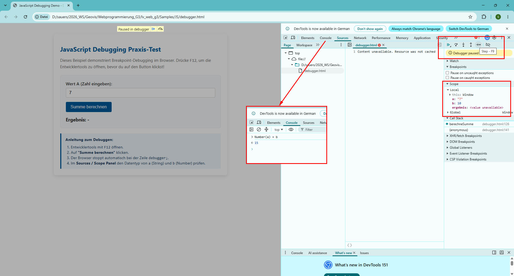

<!-- _class: titlepage -->
# Webprogrammierung: JavaScript Grundlagen und Datenstrukturen

**Fachlehrer  Stefan Sauer**
**THWS Geovisualisierung**

---
<!-- _class: structural -->
# Inhaltsverzeichnis

- [Javascript Grundlagen](#javascript-grundlagen)
- [Variablen und Datentypen](#variablen-und-datentypen)
- [Kontrollstrukturen, Funktionen & Scope](#kontrollstrukturen-funktionen-scope)
- [Schleifen & moderne Iteration](#schleifen-moderne-iteration)
- [Funktionen & Arrow Functions](#funktionen-arrow-functions)
- [Komplexe Datenstrukturen (Objekte & Arrays)](#komplexe-datenstrukturen-objekte-arrays)

---


## Javascript Grundlagen

> Wenn html das Grundgerüst und css das Design ist, dann ist Javascript das was Leben einhaucht!

---
<!-- _class: structural-->
### Einführung & Moderne Sprachgrundlagen
**Übersicht:**
- Woher kommt JavaScript
- Was javascript (nicht) kann
- Sicherheit
- ECMAscript 
- Entwicklertools

---

#### Woher kommt JavaScript?

- Erfunden 1995 von "Netscape"
- später später mit ECMA
(European Computer Manufacturers Association) weiter entwickelt
- Javascript ist nicht gleich Java!

---
#### Was Javascript kann
- kann komplette Anwendungen entwickeln
- kann grafische Objekte manipulieren und animieren
- kann Elemente dynamisieren
- kann Daten zwischen Browser und Webserver austauschen,
ohne dass Seite neu geladen werden muss
- kann Daten auf dem Client speichern
- kann lokalisierte Informationen anzeigen
- kann Daten des Clientrechners auswerten und  Seiten und Inhalte an die Gegebenheiten des Besuchers anpassen

---
#### Was Javascript nicht kann
- keine Datenbank abfragen
- keine Dateien auf dem Server speichern oder organisieren
- kann keine Programme auf dem Server ausführen
- kann keine Informationen aus anderen Webseiten abrufen, da diese mit CORS-Mechanismen geschützt sein können.
- kann Standardmäßig nicht direkt auf das Dateisystem des Computers zugreifen (aus Sicherheitsgründen)
- kann nicht direkt auf die Hardware des Computers zugreifen (aus Sicherheitsgründen)

---
#### Javascript und Sicherheit

Früher war Javascript ein Sicherheitsrisiko.
Heute ist es das nicht mehr. Die Programmiersprache
wird von den Herstellern der Browser stark reglementiert.

> Javascript läuft also nur im "Sandkasten" (Sandbox) des Browsers!

---
#### ECMAScript vs. JavaScript-Engines
- **ECMAScript (ES):** Der offizielle **Bauplan** (Standard & Spezifikation)
  - Legt Regeln, Syntax und neue Features fest (z. B. ES6, `const`/`let`, Arrow Functions).
  - Sagt, *wie* JavaScript geschrieben werden muss.
- **JS-Engine:** Der **Motor** (die Software im Browser)
  - Liest den JavaScript-Code und übersetzt ihn in Maschinencode (Ausführung).
  - Setzt den ECMAScript-Bauplan in der Praxis um.
- **Die bekanntesten Engines:**
  - **V8:** Google Chrome, Node.js, Microsoft Edge, Brave
  - **JavaScriptCore (Nitro):** Apple Safari (iOS / macOS)
  - **SpiderMonkey:** Mozilla Firefox

---

ECMAScript ist das **Rezept**,
die JS-Engine ist der **Koch**,
der das **Gericht** zubereitet!

> Javascript wird  zur Laufzeit von der JS-Engine des Browsers übersetzt, interpretiert und ausgeführt.

---
#### Entwicklertools & Debugging

Entwicklertools der Browser (Console, Sources, Debugging)


- **Überblick:** Alle modernen Browser (Chrome, Firefox, Edge, Safari) bieten integrierte Entwicklerwerkzeuge (DevTools).
- **Zugriff:** Taste `F12` oder `Rechtsklick -> Element untersuchen`.
- **Die wichtigsten Tabs:**
  - **Console:** Interaktives Terminal für JS-Befehle, Fehlermeldungen & Ausgaben (`console.log()`, `console.error()`).
  - **Sources:** Einsicht in geladene `.js`-Dateien, Quellcode-Inspektion & Breakpoints.
  - **Network:** Überwachung aller Netzwerkanfragen (z. B. API-Aufrufe/Fetch).


---

> Die DevTools sind das Röntgengerät des Webentwicklers – sie machen die unsichtbare Laufzeit im Browser sichtbar!

---
#### Breakpoint-Debugging: Code anhalten & untersuchen
- **Warum Breakpoints statt nur `console.log()`?**
  - `console.log()` vermüllt den Code und zeigt nur statische Momentaufnahmen.
  - Breakpoints halten das Programm zur Laufzeit in der JS-Engine an!
- **Workflow im Sources-Tab:**
  1. Klick auf die Zeilennummer im Code setzt einen **Breakpoint**.
  2. Die Ausführung stoppt sofort, wenn die Zeile erreicht wird.
  3. **Scope & Inspector:** Live-Einsicht in alle aktuellen Variablenwerte und den Aufrufstapel (Call Stack).
- **Steuerung im Debugger:**
  - **Step Over ($F10$):** Zur nächsten Zeile springen.
  - **Step Into ($F11$):** In die Funktionsausführung hineinspringen.
  - **Resume ($F8$):** Normale Programmausführung fortsetzen.

---
#### Das `debugger;`-Statement & Konsole-Fehler verstehen
- **Code-Stopp per Befehl:**
  - Das Statement `debugger;` im JS-Code wirkt wie ein fest eingebauter Breakpoint (sofern die DevTools geöffnet sind).
- **Die 3 häufigsten JS-Fehler in der Console lesen:**
  - **ReferenceError:** Variable ist nicht deklariert oder falsch geschrieben (`x is not defined`).
  - **TypeError:** Zugriff/Methode auf `null` oder `undefined` (`Cannot read properties of undefined`).
  - **SyntaxError:** Code verstößt gegen die Syntaxregeln (z. B. fehlende Klammer `)`).

---

> **Praxis-Tipp:** Ein Klick auf die Zeilennummer rechts neben der Fehlermeldung in der Konsole springt direkt zur Fehlerquelle im Sources-Tab!

---
#### Praxis-Beispiel zum Nachbasteln: Bug-Hunting
```html
<button id="calcBtn">Summe berechnen</button>
<p id="result"></p>

<script>
  function berechneSumme(a, b) {
    debugger; // Stoppt automatisch bei geöffneten DevTools!
    return a + b;
  }
  document.getElementById("calcBtn").addEventListener("click", () => {
    let eingabeA = "5"; // Achtung: Wert aus Input-Feld ist ein String!
    let eingabeB = 10;
    let summe = berechneSumme(eingabeA, eingabeB);
    document.getElementById("result").innerText = "Ergebnis: " + summe;
  });
</script>
```

---
#### Schritt-für-Schritt: Vorgehensweise beim Debuggen
- **1. DevTools öffnen:** Seite laden und `F12` (oder `Rechtsklick -> Untersuchen`) drücken.
- **2. Aktion ausführen:** Klick auf den Button "Summe berechnen".
  - 🛑 Browser stoppt automatisch bei `debugger;` in der Funktion `berechneSumme()`.
- **3. Variablen inspizieren (Sources-Tab -> Scope):**
  - Fahre mit der Maus über `a` und `b` oder prüfe das **Scope-Panel**.
  - Erkenne den Typ: `a = "5"` (String) vs. `b = 10` (Number).
- **4. Fehlerursache:** `a + b` führt wegen String-Konkatenation zu `"510"` statt `15`.
- **5. Live-Fix in der Console testen:** In der Konsole `Number(a) + b` ausführen -> `15`.

---
<!-- _class: fullscreen-->




---
#### Der didaktische Debugging-Workflow
- **1. Konsole prüfen:** Gibt es rote Fehlermeldungen (z. B. `TypeError`)?
- **2. Breakpoint setzen:** Zeilennummer im *Sources-Tab* anklicken oder `debugger;` einbauen.
- **3. Variablenzustand durchleuchten:** Werte im *Scope*-Fenster zur Laufzeit analysieren.
- **4. Code Schritt für Schritt ausführen:** Mit $F10$ (Step Over) den Ablauf kontrollieren.
- **5. Fehler beheben:** Typumwandlung ergänzen (`Number(...)`) & Code korrigieren.

>Debuggen ist systematische Hypothesenprüfung – nicht Raten!

---
### Einbindung von Javascript

Saubere Einbindung im HTML: <script defer> und ES-Module (type="module")
- **Drei Wege zur Einbindung:** Inline (veraltet), Intern (`<script>`), Extern (`<script src="...">`).

---
#### Die 3 Arten der JavaScript-Einbindung

1. **Inline-Event-Handler (Veraltet / No-Go):**
   - `<button onclick="alert('Hallo!')">Klick</button>`
   - ❌ Vermischt HTML & Logik, schwer wartbar, Sicherheitsrisiken.
2. **Internes Skript (`<script>`-Tag im HTML):**
   - `<script> console.log("Hallo Welt"); </script>`
   - ✅ Gut für kleine Test-Skripte & Demos. ❌ Nicht wiederverwendbar.
3. **Externes Skript (Standard & Best Practice):**
   - `<script src="app.js"></script>`
   - ✅ **Saubere Trennung**, Browser-Caching, wiederverwendbar.

---
#### Vergleich: Vor- und Nachteile der Einbindung

| Methode | Beispiel | Vorteile | Nachteile |
| :--- | :--- | :--- | :--- |
| **Inline** *(veraltet)* | `onclick="..."` | Schnell für 1-Zeiler | Vermischt HTML & JS, kein Caching, Sicherheitsrisiko |
| **Intern** | `<script>...</script>` | Kein Extra-HTTP-Request | Kein Caching für JS, macht HTML unübersichtlich |
| **Extern** *(Standard)* | `<script src="..."></script>` | **Wiederverwendbar**, **Browser-Caching**, saubere Struktur | Benötigt Netzwerk-Request (gecached) |

---

 **Grundregel:**
Trenne immer:
- Inhalt (HTML)
- Layout (CSS)
- Verhalten (JS)

**Hinweis:**
Veraltete Attribute wie **language="javascript"**
werden nicht mehr genutzt.

---
### Ladeverhalten optimieren: Das `defer`-Attribut

- **Klassisches Verhalten (ohne Attribut):**
  - Skript lädt & führt sofort aus -> **blockiert das Parsen des HTML-DOMs**.
- **Die moderne Lösung: `<script defer src="app.js">`**
  - **`defer` (Aufschieben):** Lädt das Skript im Hintergrund herunter.
  - Ausführung erfolgt **erst, nachdem das HTML vollständig aufgebaut (geparst) ist**.
  - Garantiert die korrekte Ausführungsreihenfolge mehrerer Skripte.
- **Unterschied zu `async`:**
  - `async` führt das Skript sofort nach dem Download aus (gut für unabhängige Analyse-Tools).

---

> **Best Practice:**
Platziere externe Skripte im <head> und nutze immer defer!

---
### Modern & Modular: ES-Module (`type="module"`)

- **Einbindung:**
  - `<script type="module" src="app.js"></script>`
- **Die wichtigsten Eigenschaften von ES-Modulen:**
  - **`import` & `export`:** Code lässt sich in wiederverwendbare Dateien aufteilen.
  - **Automatisches `defer`:** Modul-Skripte werden standardmäßig aufschiebend geladen.
  - **Eigener Scope:** Variablen verschmutzen nicht den globalen `window`-Namensraum.
  - **Strict Mode:** Läuft automatisch im modernen `"use strict"`-Modus.

```javascript
// math.js (Funktion exportieren)
export function summe(a, b) { return a + b; }

// app.js (Funktion importieren & nutzen)
import { summe } from './math.js';
```


---
### Praxis-Beispiel: Modularer Code (`calculator.js`)

```javascript
// calculator.js (Hilfsmodul)

// Privat: Nicht exportiert -> Von außen unsichtbar!
function formatierErgebnis(wert) {
    return `[Ergebnis: ${wert}]`;
}

// Öffentlich: Durch 'export' für andere Dateien verfügbar
export function addieren(a, b) {
    return formatierErgebnis(Number(a) + Number(b));
}

export function subtrahieren(a, b) {
    return formatierErgebnis(Number(a) - Number(b));
}
```

---

### Hauptskript & HTML-Einbindung (`main.js` & HTML)

```javascript
// main.js (Hauptprogramm)
import { addieren, subtrahieren } from './calculator.js';

document.getElementById('addBtn').addEventListener('click', () => {
    const valA = document.getElementById('numA').value;
    const valB = document.getElementById('numB').value;
    document.getElementById('output').innerText = addieren(valA, valB);
});
```

```html
<!-- HTML-Einbindung: type="module" aktiviert import/export -->
<script type="module" src="main.js"></script>
```

---
### Wichtige Stolperfallen bei ES-Modulen

- **1. Pfadangabe beim Import:**
  - ❌ `import { addieren } from 'calculator.js';` *(Fehler im Browser!)*
  - ✅ `import { addieren } from './calculator.js';` *(Relativer Pfad mit `./` Pflicht!)*
- **2. Browser-Sicherheitsregel (CORS / `file://`):**
  - Öffnen per Doppelklick (`file:///...`) wird aus Sicherheitsgründen blockiert.
  - **Lösung:** Ausführung über lokalen Server (z. B. VS Code Extension *Live Server*).

> **Beispiel zum Ausprobieren:** Liegt spielfertig unter [`Samples/JS/modules-demo.html`](../Samples/JS/modules-demo.html).

---
### Hands-on 1: Internes Skript Schritt für Schritt

**Ziel:** Erstes JavaScript direkt im HTML einbetten und die Browser-Konsole kennenlernen.

1. **Datei anlegen:** Erstelle in VS Code eine neue Datei `01_intern.html`.
2. **Code abtippen:** Füge folgendes Grundgerüst mit dem `<script>`-Tag am Ende des `<body>` ein:
```html
<!DOCTYPE html>
<html lang="de">
<body>
  <h1>Mein erstes JavaScript</h1>
  <script>    // Schreibt eine Textnachricht in die Entwicklertools (Reiter Console):
    console.log("Hallo Welt! Das Skript wurde geladen.");
        alert("Willkommen zur Webprogrammierung!"); // Öffnet ein Hinweisfenster direkt im Browser:
  </script>
</body>
</html>
```
---

3. **Ausführen & Verifizieren:**
   - Öffne die Datei im Browser per Doppelklick. Bestätige das Popup mit **OK**.
   - Drücke `F12` (oder Rechtsklick ➔ *Untersuchen*) und wechsle auf den Reiter **Console**. Siehst du den Text?

---
### Hands-on 2: Externes Skript mit `defer` Schritt für Schritt

**Ziel:** HTML und JavaScript sauber in zwei Dateien trennen und blockierungsfrei im `<head>` verknüpfen.

1. **Zwei Dateien im selben Ordner anlegen:** `02_extern.html` und `mein_skript.js`.
2. **In `mein_skript.js` schreiben (Reine JS-Datei, KEINE HTML-Tags!):**
```javascript
// mein_skript.js
console.log("Schritt 1: Externe JS-Datei erfolgreich geladen!");
alert("Schritt 2: Gruß aus der ausgelagerten JavaScript-Datei!");
```
---

3. **In `02_extern.html` im `<head>` verknüpfen:**
```html
<head>
  <title>Externe Einbindung</title>
  <!-- defer: Lädt im Hintergrund, führt erst nach dem HTML-Aufbau aus -->
  <script defer src="mein_skript.js"></script>
</head>
<body>
  <h1>Externe Skript-Trennung</h1>
</body>
```
4. **Ausführen & Verifizieren:** Datei im Browser öffnen und per `F12` in der Konsole prüfen.

---
### Hands-on 3: ES-Module (`type="module"`) Schritt für Schritt

**Ziel:** Code modular aufteilen – eine Funktion in Datei A bereitstellen (`export`) und in Datei B nutzen (`import`).

1. **Drei Dateien im selben Ordner anlegen:** `03_modul.html`, `gruesser.js` und `app.js`.
2. **Modul `gruesser.js` schreiben (Export):**
```javascript
// gruesser.js: Mit 'export' wird die Funktion für andere Dateien freigegeben
export function sageHallo(name) {
    return "Hallo " + name + "! Dein erstes ES-Modul funktioniert.";
}
```
---
3. **Hauptprogramm `app.js` schreiben (Import & Aufruf):**
```javascript
// app.js: Import mit relativem Pfad './'
import { sageHallo } from './gruesser.js';
console.log(sageHallo("Geovis-Studi"));
```

4. **In `03_modul.html` einbinden & starten:**
```html
<!-- type="module" aktiviert die Unterstützung für import/export -->
<script type="module" src="app.js"></script>
```
5. **Wichtig:** `03_modul.html` ➔ **Open with Live Server** (Module benötigen HTTP!).

---
<!-- _class: structural-->
## Variablen und Datentypen

**Übersicht:**
- Variablendeklaration (`const`, `let`)
- 7 primitive Typen
- strikte Vergleiche (`===`).

---
### Variablen deklarieren: `const` vs. `let` (vs. `var`)

- **`const` (Standard):**
  - Für Variablen, deren Referenz **nicht verändert** wird.
  - Verhindert unbeabsichtigtes Überschreiben (`const pi = 3.14159;`).
- **`let` (Veränderlich):**
  - Für Variablen, deren Wert sich **später ändert** (z. B. Zähler in Schleifen).
  - Gültig nur im jeweiligen Code-Block (*Block Scope* `{ ... }`).
- **❌ Entfall: Kein `var` mehr nutzen!**
  - `var` hat keinen Block-Scope und leidet unter *Hoisting* (Hochziehen von Variablen).
  Führt in der Praxis zu schwer auffindbaren Bugs.

---
### Was ist Hoisting ("Hochziehen")?

Die JS-Engine zieht Deklarationen vor der Ausführung gedanklich an den Anfang des Scopes:

- **`var` (Gefährlich):**
  - Deklaration wird hochgezogen, Zuweisung bleibt stehen
  ➔ Zugriff vor Zeile ergibt `undefined` (kein Fehler!).
- **`let` & `const` (Sicher):**
  - Liegen vor der Zuweisungszeile in der **Temporal Dead Zone (TDZ)**
  ➔ Zugriff erzeugt einen sauberen `ReferenceError`.
- **`function` (Bequem):**
  - Werden komplett hochgezogen ➔ Können im Code auch oberhalb ihrer Definition aufgerufen werden.

```javascript
console.log(a); // undefined (mit var)
var a = 5;

console.log(b); // ReferenceError: Cannot access 'b' before initialization
let b = 10;
```

---

> **Regel:** Nutze immer *const*. Erst wenn der Wert neu zugewiesen werden muss, ändere es zu *let*!

Weitere Informationen unter:
https://www.cancode.de/blog-article/die-eigenheiten-von-var-let-und-const-in-javascript


---
### Die 7 primitiven Datentypen in JavaScript

Primitive Daten sind **unveränderlich** (*immutable*) und werden direkt als Wert gespeichert:

1. **`string`**: Textdaten (`"Hallo"`, `'Welt'`)
2. **`number`**: Zahlen & Kommazahlen (`42`, `3.14`, `NaN`)
3. **`boolean`**: Wahrheitswerte (`true` / `false`)
4. **`undefined`**: Variable deklariert, aber noch kein Wert zugewiesen (`let x;`)
5. **`null`**: Bewusste Abwesenheit eines Werts (`const daten = null;`)
6. **`bigint`**: Beliebig große Ganzzahlen (`9007199254740991n`)
7. **`symbol`**: Eindeutiger Identifikator (`Symbol("id")`)

Typprüfung im Code mit dem Operator `typeof` (z. B. `typeof "Hallo"` ➔ `"string"`).

---
### Vergleiche: Strikte (`===`) vs. Lose (`==`) Gleichheit

- **Lose Gleichheit (`==`): Gefährlich!**
  - Führt eine **automatische Typkonvertierung** (*Type Coercion*) durch.
  - `"5" == 5` ➔ `true` | `0 == false` ➔ `true` | `"" == 0` ➔ `true`
- **Strikte Gleichheit (`===`): Best Practice!**
  - Vergleicht **Wert UND Datentyp** (ohne implizite Typumwandlung).
  - `"5" === 5` ➔ `false` *(String vs. Number)*
  - `5 === 5` ➔ `true`

> **Merksatz:** Verwende in JavaScript immer `===` und `!==`, um unerwartete Typ-Bugs zu vermeiden!

---
### Praxis-Check: Datentypen & Vergleiche in der Konsole

```javascript
const name = "Anna";   // String
let alter = 22;        // Number
let istStudent = true; // Boolean

console.log(typeof name);  // "string"
console.log(typeof alter); // "number"

// Vergleichstest:
console.log("22" == alter);  // true  (Lose Gleichheit -> Typumwandlung!)
console.log("22" === alter); // false (Strikte Gleichheit -> Sicherer Standard!)
```

> **Sonderfall / Kuriosität:** `typeof null` gibt historisch bedingt `"object"` zurück (bekannter JS-Bug seit 1995).

---
### String-Verarbeitung & Template Literals

Strings erstellen und verarbeiten (Eigenschaften & Methoden)

 **Übersicht:**
 -Nützliche String-Methoden
 - Template Literals (Backticks)
 - mehrzeilige Strings.

---
### Strings verarbeiten: Wichtige Eigenschaften & Methoden

Strings sind Zeichenketten mit vielen eingebauten Hilfsmitteln:

- **`text.length`**: Anzahl der Zeichen im String (`"Hallo".length` ➔ `5`).
- **`text.toUpperCase()` / `.toLowerCase()`**: Wandelt den Text um (`"hi".toUpperCase()` ➔ `"HI"`).
- **`text.includes("web")`**: Prüft, ob ein Teiltext enthalten ist (liefert `true` / `false`).
- **`text.trim()`**: Entfernt Leerzeichen am Anfang und Ende.
- **`text.slice(0, 4)`**: Schneidet einen Teilstring heraus (`"JavaScript".slice(0, 4)` ➔ `"Java"`).

---
### Template Literals: Die Macht der Backticks (`` ` ``)

Mit Backticks (`` `...` ``) werden Strings dynamisch und lesbar:

- **String-Interpolation (`${...}`):**
  - Bette Variablen & Ausdrücke direkt im Text ein: `` `Preis: ${preis * 1.19} €` ``.
- **Mehrzeilige Strings (Multiline):**
  - Zeilenumbrüche können direkt im Code getippt werden (kein `\n` erforderlich!).

```javascript
const name = "Alex";
const punkte = 42;

// Dynamisch & Mehrzeilig:
const nachricht = `Hallo ${name},
willkommen zurück! 
Deine Punkte: ${punkte}`;
```

---
### Vorher vs. Nachher: `+`-Konkatenation vs. Backticks

- **Veraltet (unübersichtliche `+`-Verknüpfung):**
  ```javascript
  const info = "User: " + vorname + " " + namename + " (" + alter + " Jahre)";
  ```
- **Modern & Sauber (Template Literals):**
  ```javascript
  const info = `User: ${vorname} ${namename} (${alter} Jahre)`;
  ```

> **Regel:** Nutze für jeden zusammengesetzten oder mehrzeiligen Text immer Template Literals (Backticks)!

---
### Hands-on 1 (1/2): `const` vs. `let` – Der Neuzuweisungs-Test

**Ziel:** Den Unterschied zwischen unveränderlichen (`const`) und veränderlichen (`let`) Variablen in der Praxis erleben.

1. **Datei anlegen:** Erstelle in VS Code eine neue Datei `04_variablen.html`.
2. **Code mit `<script>`-Block abtippen:**
```html
<!DOCTYPE html>
<html lang="de">...
<body> <h1>Hands-on 1: const vs. let</h1>  
  <script>
    const modulName = "Webprogrammierung";// 1. Fester Wert mit const (Konstante):
    console.log("Modul:", modulName);
    modulName = "Geovisualisierung"; // 2. Versuch, const zu überschreiben (Provozierter Fehler!):
  </script>
</body>
</html>
```

---
### Hands-on 1 (2/2): Fehler in der Konsole verstehen & beheben

3. **Ausführen & Fehler in der Konsole sehen:**
   - Öffne `04_variablen.html` im Browser und drücke `F12` ➔ Reiter **Console**.
   - Du siehst eine rote Fehlermeldung:  
     `TypeError: Assignment to constant variable.`
   - *Lerneffekt:* Der Browser verbietet das Überschreiben einer `const`-Variable!
4. **Fehler beheben (Code anpassen):**
   - Ändere die Deklaration zu `let`, damit der Wert verändert werden darf:
```javascript
let punkte = 10;
console.log("Startpunkte:", punkte);

punkte = 15; // Erlaubt, da mit 'let' deklariert!
console.log("Neue Punkte:", punkte);
```
   - Speichere und lade die Seite im Browser neu (`F5`). Die rote Meldung ist weg!

---
### Hands-on 2 (1/2): Datentypen mit `typeof` erforschen

**Ziel:** Primitive Datentypen (Text, Zahl, Boolean) deklarieren und ihren Typ ermitteln.

1. **Datei anlegen:** Erstelle in VS Code eine neue Datei `05_datentypen.html`.

---

2. **Variablen verschiedener Typen deklarieren:**
```html
<!DOCTYPE html>
<html lang="de">
<body>
  <h1>Hands-on 2: Datentypen prüfen</h1>
  <script>
    const stadt = "Würzburg";      // Typ: string (Text)
    const plz = 97070;              // Typ: number (Zahl)
    const istHauptstadt = false;    // Typ: boolean (Wahrheitswert)
    let geodaten;                   // Typ: undefined (noch kein Wert zugewiesen)

    console.log("stadt ist:", typeof stadt);
    console.log("plz ist:", typeof plz);
    console.log("istHauptstadt ist:", typeof istHauptstadt);
    console.log("geodaten ist:", typeof geodaten);
  </script>
</body>
</html>
```

---
### Hands-on 2 (2/2): Vergleiche testen – `===` vs. `==`

3. **Typvergleiche im Skript ergänzen:**
   - Schreibe zusätzlich folgende Zeilen in deinen `<script>`-Block:
```javascript
const eingabeZahl = 42;
const eingabeText = "42";
// 1. Loser Vergleich mit == (automatische Typumwandlung):
console.log("Loser Vergleich (==):", eingabeZahl == eingabeText);
// Ausgabe: true (Browser wandelt den Text "42" heimlich in eine Zahl um!)
// 2. Strikter Vergleich mit === (Prüft Wert UND Datentyp):
console.log("Strikter Vergleich (===):", eingabeZahl === eingabeText);
// Ausgabe: false (Zahl ist ungleich Text!)
```
4. **Ausführen & Verifizieren:**
   - Im Browser öffnen, `F12` drücken und beide Konsolen-Ausgaben vergleichen.
   - *Merksatz:* Immer `===` nutzen, um versteckte Typ-Fehler zu vermeiden!

---
### Hands-on 3 (1/2): Template Literals mit Backticks (`` ` ``)

**Ziel:** Variablen lesbar mit Backticks und `${...}` in Texte einbetten.
1. **Datei anlegen:** Erstelle in VS Code eine neue Datei `06_strings.html`.
---

2. **Text zusammenbauen:** Tippe folgenden Code in den `<body>`:
```html
<!DOCTYPE html>
<html lang="de">
<body>
  <h1>Hands-on 3: Strings & Backticks</h1>
  <script>
    const vorname = "Stefan";
    const rolle = "Geovis-Dozent";
    const semester = 3;
    // Mit Backticks (Taste links neben Backspace mit Shift):
    const steckbrief = `Hallo, ich bin ${vorname}.
Rolle: ${rolle}
Aktuelles Semester: ${semester}. Semester`;
    console.log(steckbrief);
  </script>
</body>
</html>
```

---
### Hands-on 3 (2/2): String-Methoden kombinieren & Testen

3. **Eingebaute String-Methoden anwenden:**
   - Ergänze im Skript Methoden für Textlänge und Großbuchstaben:
```javascript
const ort = "Würzburg";
// 1. Text in Großbuchstaben umwandeln:
console.log("Groß:", ort.toUpperCase()); // "WÜRZBURG"
// 2. Anzahl der Zeichen ermitteln (.length):
console.log("Zeichenanzahl:", ort.length); // 8
// 3. Im Template Literal kombinieren:
console.log(`Der Ort ${ort.toUpperCase()} hat ${ort.length} Buchstaben.`);
```
4. **Ausführen & Beobachten:**
   - Datei im Browser öffnen und `F12` ➔ **Console** prüfen.
   - *Beachte:* Der mehrzeilige Text aus Teil 1 behält in der Konsole exakt seine Zeilenumbrüche!

---
<!-- _class: structural-->
## Kontrollstrukturen, Funktionen & Scope

### Kontrollstrukturen & Entscheidungen

**Übersicht:**
- Verzweigungen (`if/else`)
- Mehrfachauswahl (`switch/case`)
- ternärer Operator (`? :`).

---
### Verzweigungen: `if`, `else if` und `else`

Steuere den Programmfluss basierend auf Wahrheitswerten (`true` / `false`):

```javascript
const alter = 18;

if (alter >= 18) {
    console.log("Volljährig: Zutritt gestattet.");
} else if (alter >= 16) {
    console.log("Zutritt in Begleitung gestattet.");
} else {
    console.log("Kein Zutritt.");
}
```

- **Ablauf:** Bedingungen werden sequenziell von oben nach unten geprüft.
- **Logik:** Sobald eine Bedingung `true` ergibt, wird dieser Block ausgeführt
und der Rest übersprungen.

---
### Mehrfachauswahl: `switch` / `case`

Ideal, wenn eine einzelne Variable auf **mehrere konkrete Werte** geprüft werden soll:

```javascript
const rolle = "admin";

switch (rolle) {
    case "admin":
        console.log("Vollzugriff gewährt.");
        break; // Verhindert das Durchfallen in den nächsten Case!
    case "editor":
        console.log("Inhalte bearbeiten erlaubt.");
        break;
    default:
        console.log("Standard: Nur Lesezugriff.");
}
```

> **Wichtig:** Ohne *break*; führt JS automatisch die darunterliegenden *case*-Blöcke aus (*Fallthrough*).

---
### Der Ternäre Operator (*Bedingung ? Wert1 : Wert2*)

Kompakte Kurzschreibweise für einfache `if / else`-Entscheidungen, die einen Wert zurückliefern:

```javascript
const alter = 20;

// Klassisch (if / else):
let statusText;
if (alter >= 18) { statusText = "Erwachsen"; } else { statusText = "Minderjährig"; }

// Elegant mit Ternärem Operator:
const statusText = alter >= 18 ? "Erwachsen" : "Minderjährig";
```

> **Best Practice:** Nutze den ternären Operator für prägnante Einzeiler. Vermeide Schachtelungen!

---
### Praxis-Beispiel: Kombination aller 3 Entscheidungen

```javascript
// 1. IF / ELSE IF / ELSE: Bereichsprüfung (Alter)
if (alter < 6) { basispreis = 0; }
else if (alter < 18) { basispreis = 8.00; } // Ermäßigt
else { basispreis = 12.00; }               // Standard

// 2. SWITCH / CASE: Exakter Abgleich (Wochentag)
switch (tag) {
    case "Dienstag": endpreis = basispreis * 0.8; break; // Kinotag
    case "Mittwoch": endpreis = basispreis - 2.0; break; // Studententag
    default: endpreis = basispreis; break;
}

// 3. TERNÄRER OPERATOR: Einzeiler für Statusmeldung
const seatText = isVip ? "VIP-Lounge (+ 5 €)" : "Standard-Platz";
```

---
### Entscheidungs-Matrix: Wann nutzt man was?

| Kontrollstruktur | Ideal für... | Beispiel-Usecase |
| :--- | :--- | :--- |
| **`if / else`** | **Bereichstests** (`<`, `>`, `>=`) & komplexe Bedingungen (`&&`, `\|\|`) | Altersprüfungen, Notenberechnung |
| **`switch / case`** | **Exakte Wertabgleiche** einer Variable bei vielen Alternativen | Wochentage, Benutzerrollen, Menüauswahl |
| **Ternär (`? :`)** | **Kompakte Zuweisungen** auf Basis einer Ja/Nein-Frage | Status-Texte, Standardwerte setzen |

**Beispiel zum Ausprobieren:**
Liegt spielfertig unter [`Samples/JS/decisions-demo.html`](../Samples/JS/decisions-demo.html).

---
## Schleifen & moderne Iteration

**Klassische Schleifen:**
- for
- while
- do-while

**Moderne Iteration:**
- for...of für Werte
- for...in für Objekteigenschaften

---
### Klassische Schleifen: `for`, `while` & `do-while`

- **Zählschleife (`for`):** Bekannte Anzahl an Durchläufen.
  ```javascript
  for (let i = 0; i < 3; i++) {
      console.log(`Durchlauf: ${i}`); // 0, 1, 2
  }
  ```
- **Kopfgesteuerte Schleife (`while`):** Prüft Bedingung **vor** dem Durchlauf.
  ```javascript
  let countdown = 3;
  while (countdown > 0) { console.log(countdown--); }
  ```
- **Fußgesteuerte Schleife (`do...while`):** Wird **mindestens 1-mal** ausgeführt (Prüfung danach).
  ```javascript
  let eingabe;
  do { eingabe = "ja"; } while (eingabe !== "ja");
  ```

---
### Moderne Iteration: `for...of` vs. `for...in`

- **`for...of` (Für Werte in Arrays / Iterables):**
  - Iteriert direkt über die **Elemente** (sauber & ohne Index-Stress).
  ```javascript
  const staedte = ["Würzburg", "Nürnberg", "München"];
  for (const stadt of staedte) {
      console.log(stadt); // "Würzburg", "Nürnberg", ...
  }
  ```
- **`for...in` (Für Schlüssel / Objekteigenschaften):**
  - Iteriert über die **Keys** eines Objekts.
  ```javascript
  const user = { name: "Anna", rolle: "Admin" };
  for (const key in user) {
      console.log(`${key}: ${user[key]}`); // "name: Anna", ...
  }
  ```
---
> **Faustregel:** *for...of* für Arrays (Werte),
*for...in* für Objekte (Keys)!

---
### Schleifensteuerung: `break` & `continue`

Steuere den Ablauf innerhalb einer laufenden Schleife gezielt:

- **`break` (Sofortiger Abbruch):**
  - Beendet die Schleife komplett und springt dahinter.
  ```javascript
  for (let i = 1; i <= 10; i++) {
      if (i === 4) break; // Stoppt die Schleife bei 4!
      console.log(i); // Gibt 1, 2, 3 aus
  }
  ```
- **`continue` (Überspringen des aktuellen Durchlaufs):**
  - Bricht nur den aktuellen Durchgang ab und springt zum nächsten.
  ```javascript
  for (let i = 1; i <= 4; i++) {
      if (i === 3) continue; // Überspringt nur die 3!
      console.log(i); // Gibt 1, 2, 4 aus
  }
  ```

---
### Übersicht & Best Practices der Iteration

| Schleife | Liest... | Haupt-Anwendungsfall |
| :--- | :--- | :--- |
| **`for`** | Index (`i++`) | Feste Anzahl / komplexe Zählschritte |
| **`while`** | Bedingung (`true`) | Warten auf Ereignis / dynamischer Zustand |
| **`for...of`** *(Standard)* | **Werte** | **Arrays & Kollektionen** durchlaufen |
| **`for...in`** | **Keys (Schlüssel)** | **Objekt-Eigenschaften** inspizieren |

> **Best Practice:** Nutze in modernem JavaScript für Arrays fast immer *for...of* – das vermeidet Typfehler und ist am lesbarsten.

---
### Praxis-Check: Schleifen & Iteration im Einsatz

- **Ausführbare Demodatei:** [`Samples/JS/loops-demo.html`](../Samples/JS/loops-demo.html)
- **Interaktiver Test im Browser:**
  1. **`for...of`:** Liest Werte eines Arrays direkt aus (`const frucht of fruechte`).
  2. **`for...in`:** Inspiziert Schlüssel-Wert-Paare eines Objekts (`const key in produkt`).
  3. **`while`:** Zählt einen Lagerbestand herunter, solange er größer als `0` ist.
  4. **`break` & `continue`:** Demonstriert das Überspringen (`continue`) und den Abbruch (`break`).

**Ausprobieren:**
Öffne [*Samples/JS/loops-demo.html*](../Samples/JS/loops-demo.html) im Browser und teste die Buttons mit Live-Konsolenausgabe!
Code und dessen Funktion lesen und verstehen.

---
### Hands-on 1 (1/2): Entscheidungen mit `if / else` steuern

**Ziel:** Den Ablauf einer Verzweigung verstehen – Code wird nur ausgeführt, wenn eine Bedingung wahr (`true`) ist.

1. **Datei anlegen:** Erstelle in VS Code eine neue Datei `07_if_else.html`.

---

2. **HTML mit `<script>`-Block abtippen:**
```html
<!DOCTYPE html>
<html lang="de">
<body>
  <h1>Hands-on: if / else Verzweigungen</h1>
  <script>
    const punktzahl = 85;
    if (punktzahl >= 90) {
      console.log("Prädikat: Sehr gut (1,0)!");
    } else if (punktzahl >= 75) {
      console.log("Prädikat: Gut (2,0)!");
    } else {
      console.log("Prädikat: Bestanden!");
    }
  </script>
</body>
</html>
```

---
### Hands-on 1 (2/2): Werte variieren & Konsole beobachten
3. **Ausführen & Konsole prüfen:**
  - Öffne `07_if_else.html` im Browser und drücke `F12` ➔ Reiter **Console**.
   - Du siehst: `Prädikat: Gut (2,0)!` (weil 85 >= 75, aber nicht >= 90 ist).

4. **Werte experimentell verändern:**
  - Ändere im Code `const punktzahl = 95;` ➔ Speichern, im Browser neu laden (`F5`).  
     *Ausgabe:* `Prädikat: Sehr gut (1,0)!`
   - Ändere zu `const punktzahl = 50;` ➔ Speichern, `F5`.  
     *Ausgabe:* `Prädikat: Bestanden!`
   - *Lerneffekt:* Der Browser prüft von oben nach unten und führt **nur den ersten zutreffenden Block** aus.

---
### Hands-on 2 (1/2): Mehrfachauswahl mit `switch / case`

**Ziel:** Eine Variable auf feste Textwerte prüfen (ideal für Kartenebenen oder Menüs).

1. **Datei anlegen:** Erstelle in VS Code eine neue Datei `08_switch_case.html`.

---

2. **HTML mit `<script>`-Block abtippen:**
```html
<!DOCTYPE html>
<html lang="de">
<body>
  <h1>Hands-on: switch / case Auswahl</h1>
  <script>
    const kartenEbene = "satellit";
    switch (kartenEbene) {
      case "osm":
        console.log("OpenStreetMap-Hintergrund wird geladen.");
        break; // Wichtig: Beendet die switch-Verzweigung!
      case "satellit":
        console.log("Satellitenbild-Layer wird aktiviert.");
        break;
      default: console.log("Unbekannte Ebene! Standardkarte wird geladen.");
    }
  </script>
</body>
</html>
```

---
### Hands-on 2 (2/2): Das `break`-Schlüsselwort & `default` verstehen

3. **Ausführen & Konsole prüfen:**
 - Öffne `08_switch_case.html` im Browser (`F12` ➔ **Console**).  
     *Ausgabe:* `Satellitenbild-Layer wird aktiviert.`

4. **Den `default`-Fall testen:**
 - Ändere oben `const kartenEbene = "gelaende";` ➔ Speichern, `F5`.  
     *Ausgabe:* `Unbekannte Ebene! Standardkarte wird geladen.` (Der Auffang-Block greift!).

5. **Typischer Fehler: Das `break;` vergessen:**
 - Kommentiere `break;` bei `"satellit"` mit `// break;` aus.
  - Seite neu laden (`F5`): Es wird der Satelliten- **UND** der Default-Text ausgegeben!
   - *Merksatz:* Ohne `break;` "fällt" JavaScript automatisch in die darunterliegenden Cases durch!

---
### Hands-on 3 (1/2): Die Zählschleife (`for`) Schritt für Schritt

**Ziel:** Einen Code-Block automatisiert mehrmals wiederholen, ohne ihn mehrfach abzutippen.

1. **Datei anlegen:** Erstelle in VS Code eine neue Datei `09_schleifen.html`.

---

2. **Klassische Zählschleife abtippen:**
```html
<!DOCTYPE html>
<html lang="de">
<body>
  <h1>Hands-on: Schleifen in JavaScript</h1>
  <script>
    // Zählt von 1 bis 5 (i++ erhöht den Zähler in jedem Durchlauf um 1):
    for (let i = 1; i <= 5; i++) {
      console.log(`Durchlauf Nummer: ${i}`);
    }
  </script>
</body>
</html>
```
3. **Ausführen:** Datei im Browser öffnen und `F12` ➔ **Console** prüfen. Du siehst 5 Zeilen untereinander!

---
### Hands-on 3 (2/2): Listen durchlaufen mit `for...of`

**Ziel:** Eine Liste von Geodaten-Orten (Array) elegant von Anfang bis Ende durchlaufen.

---

4. **Listen-Schleife im `<script>` ergänzen:**
 - Schreibe direkt unter deine `for`-Schleife folgenden Code:
```javascript
// Ein Array (Liste) mit Geovis-Standorten:
const staedte = ["Würzburg", "Schweinfurt", "Aschaffenburg"];

// for...of holt nacheinander jeden Eintrag direkt aus der Liste:
for (const stadt of staedte) {
  console.log(`Geovis-Standort: ${stadt}`);
}
```

5. **Ausführen & Verstehen:**
   - Im Browser neu laden (`F5`).
   - *Lerneffekt:* Mit `for...of` musst du keinen Indexzähler (`i`) verwalten
   – JavaScript gibt dir direkt jedes Element!

---
<!-- _class: structural-->
## Funktionen & Arrow Functions

**Übersicht:**
- Deklarationen vs. Arrow Functions
- Default- & Rest-Parameter
- Scope & Closures.

---
### Function Declaration vs. Function Expression

- **Function Declaration (Klassische Funktion):**
  - Wird per *Hoisting* an den Anfang des Scopes gezogen
  -> vor ihrer Deklaration aufrufbar.
 ```javascript
  function gruss(name) {
      return `Hallo ${name}!`;}
  ```
- **Function Expression (Funktionsausdruck):**
  - Funktion wird in einer Variable gespeichert -> erst **ab der Zuweisung** aufrufbar.
```javascript
  const gruss = function(name) {
      return `Hallo ${name}!`;};
  ```

---

> **Unterschied:**
Declarations sind global/funktional verfügbar
Expressions folgen den normalen Variablen-Regeln (*const*).

---
### Modern & Kompakt: Arrow Functions (`=>`)

Die prägnanteste Schreibweise für Funktionen in modernem JavaScript:

```javascript
// Standard-Schreibweise:
const quadrat = (x) => { return x * x; };

// Kurzschreibweise (Impliziter Return bei Einzeilern):
const quadrat = x => x * x;
```

- **Die 3 Kern-Merkmale von Arrow Functions:**
  1. **Kompakte Syntax:** Kein `function`-Keyword erforderlich.
  2. **Implizites `return`:** Bei einzeiligen Ausdrücken ohne geschweifte Klammern `{}`.
  3. **Lexikalisches `this`:** Erbt das `this` aus dem umgebenden Kontext (ideal für Event-Handler).

---
### Standard-Parameter & Rest-Parameter (`...args`)

- **Standard-Parameter (Default Parameters):**
  - Beugt `undefined`-Fehlern vor, indem Standardwerte hinterlegt werden.
```javascript
  function erstelleUser(name = "Anonym", rolle = "Gast") {
      return `${name} (${rolle})`;
  }
  ```
- **Rest-Parameter (`...args` statt veraltetem `arguments`):**
  - Bündelt beliebig viele Argumente in ein **echtes Array**.
```javascript
  function summiere(...zahlen) {
      return zahlen.reduce((summe, n) => summe + n, 0);
  }
  summiere(5, 10, 15); // 30
  ```

---
### Scope, Lexical Environment & Closures

- **Global Scope vs. Block Scope:**
  - `const` / `let` sind streng im umschließenden Block `{ ... }` geschützt.
- **Was ist eine Closure (Funktionsabschluss)?**
  - Eine innere Funktion hat Zugriff auf Variablen ihres **äußeren Entstehungs-Scopes**,
  selbst nachdem die äußere Funktion beendet ist!

```javascript
function erstelleZaehler() {
    let count = 0; // Kapselung im Scope der Closure
    return () => ++count;
}

const zaehler = erstelleZaehler();
console.log(zaehler()); // 1
console.log(zaehler()); // 2
```

---
### Vergleich & Best Practices für Funktionen

| Merkmal | Function Declaration | Arrow Function (`=>`) |
| :--- | :--- | :--- |
| **Syntax** | `function name() {}` | `const name = () => {}` |
| **Hoisting** | Ja (überall aufrufbar) | Nein (erst nach Zeile verfügbar) |
| **`this`-Bindung** | Dynamisch (hängt vom Aufrufer ab) | Lexikalisch (erbt vom Umfeld) |
| **Impliziter Return** | Nein (benötigt `return`) | Ja (bei Einzeiler ohne `{}`) |

> **Best Practice:** Nutze **Arrow Functions** für Helper, Array-Methoden & Event-Handler. Nutze **Function Declarations** für zentrale Skript-Funktionen.

---
### Praxis-Check: Funktionen & Arrow Functions im Einsatz

- **Ausführbare Demodatei:** [`Samples/JS/functions-demo.html`](../Samples/JS/functions-demo.html)
- **Gezeigte Funktions-Konzepte:**
  1. **Default-Parameter:** `formatierPreis(betrag, waehrung = "€")` schützt vor `undefined`.
  2. **Rest-Parameter:** `berechneSumme(...preise)` fasst beliebige Werte in ein Array zusammen.
  3. **Arrow Functions (`=>`):** Implizite Rückgabe bei `.map(brutto => (brutto / 1.19).toFixed(2))`.
  4. **Closures:** `erstelleWarenkorbTracker()` kapselt den Zählerstand privat im Scope.

> **Ausprobieren:** Öffne [`Samples/JS/functions-demo.html`](../Samples/JS/functions-demo.html) im Browser und teste die Interaktionen!

---
<!-- _class: structural-->

## Komplexe Datenstrukturen (Objekte & Arrays)
**Übersicht:**
- Moderne Objektorientierung mit `class`
- Schlüssel-Wert-Speicher: Objekte & JSON-Notation
- Moderne Array-Methoden
- Destructuring & Spread-Operator

---
### Objekte & JSON-Notation (Schlüssel-Wert-Speicher)

- **Objekte in JavaScript:**
  - Sammlungen von Eigenschaften (*Key-Value Pairs*).
```javascript
  const user = { name: "Anna", alter: 22, geovisStudent: true };
  console.log(user.name);     // Punkt-Notation: "Anna"
  console.log(user["alter"]); // Klammer-Notation: 22
  ```
- **JSON (JavaScript Object Notation):**
  - Standardformat für den Datenaustausch im Web (Web-APIs & Server).
  - **`JSON.stringify(obj)`**: Wandelt ein JS-Objekt in einen JSON-String um.
  - **`JSON.parse(jsonString)`**: Wandelt einen JSON-String zurück in ein JS-Objekt.

---
### Moderne Objektorientierung mit `class`

JS-Version ES6 führte die saubere `class`-Syntax ein (ersetzt alte Prototypen-Konstruktoren):

```javascript
class Person {
    #geheimnis = 42; // Privates Feld (#) -> von außen nicht direkt lesbar!

    constructor(name, rolle) {
        this.name = name;  // Instanz-Variable
        this.rolle = rolle;
    }

    vorstellen() { // Methode
        return `Ich bin ${this.name} (${this.rolle}).`;
    }
}

const p = new Person("Max", "Dozent");
console.log(p.vorstellen()); // "Ich bin Max (Dozent)."
```

---
### Vererbung mit `extends` und `super`

Klassen können Eigenschaften und Methoden von Elternklassen erben:

```javascript
class Student extends Person {
    constructor(name, matrikelnummer) {
        // super() ruft den Konstruktor der Elternklasse (Person) auf:
        super(name, "Student");
        this.matrikelnummer = matrikelnummer;
    }

    lernen() {
        return `${this.name} (Matrikel: ${this.matrikelnummer}) lernt JS.`;
    }ng.md 
}

const s = new Student("Lisa", 632217);
console.log(s.vorstellen()); // Von Person geerbt!
console.log(s.lernen());     // Eigene Methode
```

---
### Praxis-Check: Objekte & JSON im Einsatz

- **Ausführbare Demodatei:** [`Samples/JS/objects-json-demo.html`](../Samples/JS/objects-json-demo.html)
- **Gezeigte Kernkonzepte im Code:**
  1. **JS-Objekt & Zugriffe:** Punkt-Notation (`student.name`) vs. Klammer-Notation (`student['id']`) & verschachtelte Objekte.
  2. **`JSON.stringify(obj, null, 2)`:** Wandelt ein JS-Objekt in ein lesbares JSON-String-Format um.
  3. **`JSON.parse(jsonText)`:** Parst empfangenen JSON-Text vom Server zurück in ein echtes JS-Objekt für Berechnungen.
  4. **Objekt-Methoden & `this`:** Funktions-Methoden innerhalb von Objekten mit Zugriff auf eigene Eigenschaften via `this`.

**Ausprobieren:**
Öffne [`Samples/JS/objects-json-demo.html`](../Samples/JS/objects-json-demo.html) im Browser und teste die Live-Konsole!

---
### Arrays erstellen & Grundlagen (Array-Literale `[]`)

Arrays sind **geordnete Listen** von Elementen mit 0-basiertem Index:

```javascript
// 1. Erstellung per Array-Literal [] (Best Practice!):
const staedte = ["Würzburg", "Nürnberg", "München"];

// 2. Zugriff über den 0-basierten Index & Länge prüfen:
console.log(staedte[0]);     // "Würzburg" (Erstes Element)
console.log(staedte.length);  // 3 (Gesamtzahl der Elemente)

// 3. Element am Index verändern:
staedte[1] = "Bamberg";      // Ersetzt "Nürnberg"
```

- **Eigenschaft:** Arrays können beliebige Datentypen mischen (Strings, Zahlen, Objekte).
- **Merksatz:** Nutze immer `[]` statt `new Array()`.

---
### Moderne Array-Methoden (Funktionaler Stil)

Methoden zur sauberen Datenverarbeitung ohne manuelle `for`-Schleifen:

- **`map()` (Transformieren):** Wandelt jedes Element um.
  - `[1, 2, 3].map(x => x * 2)` ➔ `[2, 4, 6]`
- **`filter()` (Filtern):** Behält nur Elemente, die die Bedingung erfüllen.
  - `[10, 5, 20].filter(x => x >= 10)` ➔ `[10, 20]`
- **`reduce()` (Aggregieren):** Berechnet einen einzelnen Gesamtwert.
  - `[10, 20, 30].reduce((sum, n) => sum + n, 0)` ➔ `60`
- **`find()` & `includes()`:** Sucht Ersttreffer (`find`) oder prüft Existenz (`includes`).

---
### Destructuring Assignment (Werte entpacken)

Kompaktes Extrahieren von Werten aus Objekten und Arrays in eigene Variablen:

```javascript
// 1. Objekt-Destructuring:
const user = { name: "Sarah", stadt: "Würzburg", alter: 24 };
const { name, stadt } = user; // Erzeugt Variablen 'name' und 'stadt'
console.log(`${name} aus ${stadt}`); // "Sarah aus Würzburg"

// 2. Array-Destructuring:
const koordinaten = [49.79, 9.93];
const [lat, lng] = koordinaten; // lat = 49.79, lng = 9.93
```

> **Vorteil:** Erspart unübersichtliches `const name = user.name; const stadt = user.stadt;`.

---
### Der Spread-Operator (`...`)

Vervielfältigt oder kombiniert Arrays und Objekte in einer neuen Struktur:

```javascript
// 1. Arrays zusammenfügen / klonen:
const primaer = ["Rot", "Blau"];
const alleFarben = [...primaer, "Grün", "Gelb"]; // ["Rot", "Blau", "Grün", "Gelb"]

// 2. Objekte erweitern / unveränderlich anpassen (Immutable Update):
const basisConfig = { theme: "dark", fontSize: 16 };
const userConfig = { ...basisConfig, fontSize: 18, sidebar: true };
```

> **Unterschied:** **Spread (`...`)** entpackt Elemente; **Rest (`...`)** packt Elemente in ein Array zusammen!


---
### Praxis-Check: Arrays & Moderne Methoden im Einsatz

- **Ausführbare Demodatei:** [`Samples/JS/arrays-demo.html`](../Samples/JS/arrays-demo.html)
- **Gezeigte Kernkonzepte im Code:**
  1. **Grundlagen (Array-Literale `[]`):** Erstellung, 0-basierter Indexzugriff (`staedte[0]`) & `.length`-Eigenschaft.
  2. **`map()` (Transformieren):** Erzeugt neues Array mit berechneten Bruttopreisen (`netto * 1.19`).
  3. **`filter()` (Filtern):** Selektiert eine Untermenge von Objekten auf Basis von Bedingungen (`nettoPreis < 50`).
  4. **`reduce()` (Aggregieren):** Summiert den gesamten Datenbestand schrittweise auf 1 Gesamtwert herunter.

**Ausprobieren:**
Öffne [`Samples/JS/arrays-demo.html`](../Samples/JS/arrays-demo.html) im Browser und teste die interaktiven Buttons!

---
<!-- _class: structural-->
